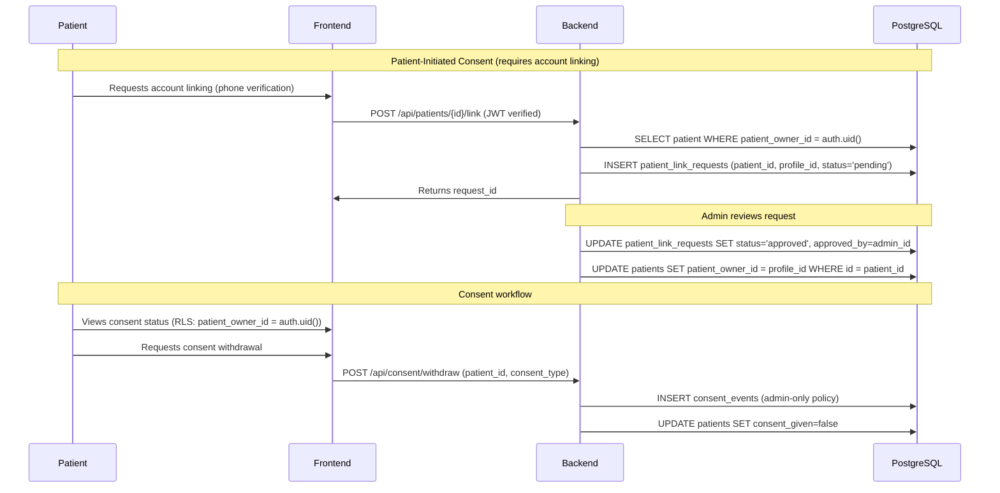

# Phase 2.6N.14E — Security Blocker Resolution

**Date:** 2026-11-01
**Type:** READ-ONLY Blocker Resolution
**Status:** AUDIT ONLY — No code changes made
**Verdict:** BLOCKERS PARTIALLY RESOLVED — Implementation NOT READY

---

## 1. Consent Event Authorization — Secure Workflow Design

### 1.1 Product Decision: Consent Event INSERT Policy

**Decision:** Consent event creation is **admin-only** (preserved from original design).

**Rationale:**
- Consent events contain PHI (patient_id, consent_type, consent_given, source, notes)
- Staff INSERT expands attack surface for PHI manipulation
- Original design intentionally restricted consent creation to admins
- Phase 2.6N.14B classified staff INSERT as a "design decision, not security fix"
- Phase 2.6N.14C confirmed: "consent_events INSERT expansion is a business design decision, not a security flaw"

### 1.2 Secure Consent Workflow



### 1.3 Authorization Model for Consent Events

| Actor | Operation | Conditions | PostgreSQL Enforcement |
|-------|-----------|------------|------------------------|
| **Patient** | SELECT own consent | `patient_owner_id = auth.uid()` OR clinic member | `FOR SELECT USING (...)` |
| **Patient** | SELECT other consent | DENIED | RLS blocks |
| **Staff** | SELECT clinic consent | `is_clinic_member(auth.uid(), clinic_id)` | `FOR SELECT USING (...)` |
| **Staff** | INSERT consent | DENIED (admin-only) | No INSERT policy for staff |
| **Admin** | SELECT all consent | `role = 'admin'` | `FOR SELECT USING (EXISTS admin)` |
| **Admin** | INSERT consent | `role = 'admin'` | `FOR INSERT WITH CHECK (EXISTS admin)` |
| **Admin** | UPDATE consent | `role = 'admin'` | `FOR UPDATE USING (EXISTS admin)` |
| **Admin** | DELETE consent | `role = 'admin'` | `FOR DELETE USING (EXISTS admin)` |

### 1.4 Immutable Consent Records

```sql
-- Existing consent events are immutable by design
-- UPDATE/DELETE policies are admin-only
-- No soft-delete or modification workflow for existing records
-- New consent events create new rows (append-only audit trail)

-- If audit trail needed for consent modifications:
CREATE TABLE public.consent_audit (
  id uuid PRIMARY KEY DEFAULT gen_random_uuid(),
  consent_event_id uuid NOT NULL REFERENCES public.consent_events(id),
  changed_by uuid NOT NULL REFERENCES public.profiles(id),
  old_values jsonb,
  new_values jsonb,
  changed_at timestamptz NOT NULL DEFAULT now()
);
```

### 1.5 Preventing Forged Patient Identity & Cross-Patient Insertion

**Current safeguards:**
1. JWT signature verification -> `verified_claims` used for all auth decisions
2. RLS policies on `consent_events` require `patient_id` -> `patient_owner_id` or clinic membership match
3. `INSERT` policy requires admin role (verified via `profiles.role = 'admin'`)

**No additional safeguards needed** — existing RLS + JWT verification already prevents:
- Forged patient identity (no `patient_id` injection without clinic membership)
- Cross-patient consent insertion (RLS blocks INSERT unless admin)

---

## 2. PostgreSQL Integration Environment Assessment

### 2.1 Current Environment State

| Component | Status | Details |
|-----------|--------|---------|
| **Docker Desktop** | Installed v29.7.2 | Daemon NOT running (failed to connect to npipe) |
| **PostgreSQL Client (psql)** | NOT installed | Not in PATH |
| **Supabase CLI** | Installed v2.122.0 | Not logged in (no access token) |
| **GitHub Actions** | NOT configured | No `.github/workflows/` directory |
| **Local PostgreSQL** | NOT installed | No `psql`, no service |

### 2.2 Recommended Testing Strategy

**Primary: GitHub Actions with PostgreSQL Container**

```yaml
# .github/workflows/rls-tests.yml
name: RLS Integration Tests
on: [push, pull_request]
jobs:
  rls-tests:
    runs-on: ubuntu-latest
    services:
      postgres:
        image: postgres:17
        env:
          POSTGRES_PASSWORD: postgres
          POSTGRES_DB: test_sharma
        ports: ["5432:5432"]
        options: >-
          --health-cmd pg_isready
          --health-interval 10s
          --health-timeout 5s
          --health-retries 5
    steps:
      - uses: actions/checkout@v4
      - name: Run migrations
        run: |
          for f in supabase/migrations/*.sql; do
            psql -h localhost -U postgres -d test_sharma -f "$f"
          done
      - name: Run RLS isolation tests
        run: psql -h localhost -U postgres -d test_sharma -f tests/rls_tests.sql
```

**Secondary: Supabase Staging Project**

```bash
# 1. Create staging project at supabase.com
# 2. Link local project
supabase link --project-ref <staging-project-ref>
# 3. Push migrations
supabase db push
# 4. Run tests against staging
psql "postgresql://postgres:<password>@db.<ref>.supabase.co:5432/postgres" -f tests/rls_tests.sql
```

**Not Recommended:**
- Windows Docker Desktop (PostgREST SIGSEGV is a known blocker)
- Local Docker without daemon fix
- Manual testing without CI/CD automation

### 2.3 Test Coverage Requirements

| Category | Tests Required | Blocked By |
|----------|----------------|------------|
| Migration application | All 4 migrations apply cleanly | PostgreSQL instance |
| RLS isolation (patient-to-patient) | 6 tests | PostgreSQL instance |
| RLS isolation (cross-clinic) | 4 tests | PostgreSQL instance |
| Role escalation prevention | 2 tests | PostgreSQL instance |
| Membership revocation | 3 tests | PostgreSQL instance |
| RPC execution permissions | 4 tests | PostgreSQL + PostgREST |
| Legacy record handling | 3 tests | PostgreSQL instance |
| Rollback procedures | 4 tests | PostgreSQL instance |

---

## 3. Seven-Table Policy Verification

### 3.1 Current Migration State (Actual Files)

| Table | Migration | SELECT | INSERT | UPDATE | DELETE | TRUNCATE | REFERENCES | TRIGGER |
|-------|-----------|--------|--------|--------|--------|----------|------------|---------|
| **profiles** | 20240102_01 | YES `auth.uid()=id` | NO FOR ALL USING | NO FOR ALL USING | NO FOR ALL USING | YES REVOKED | YES REVOKED | YES REVOKED |
| **patients** | 20240103_02 | NO ALL AUTH | YES admin WITH CHECK | YES admin USING | YES admin USING | YES REVOKED | YES REVOKED | YES REVOKED |
| **appointments** | 20240104_03 | NO ALL AUTH | YES admin WITH CHECK | YES admin USING | YES admin USING | YES REVOKED | YES REVOKED | YES REVOKED |
| **call_queue** | 20240105_04 | NO ALL AUTH | YES admin WITH CHECK | YES admin USING | YES admin USING | YES REVOKED | YES REVOKED | YES REVOKED |
| **call_logs** | 20240106_05 | NO ALL AUTH | YES admin WITH CHECK | YES admin USING | YES admin USING | YES REVOKED | YES REVOKED | YES REVOKED |
| **clinic_settings** | 20240107_06 | NO ALL AUTH | NO FOR ALL USING | NO FOR ALL USING | NO FOR ALL USING | YES REVOKED | YES REVOKED | YES REVOKED |
| **consent_events** | 20240108_07/10 | NO ALL AUTH | YES admin WITH CHECK | YES admin USING | YES admin USING | YES REVOKED | YES REVOKED | YES REVOKED |

**Legend:** YES = Correct/secure, NO = Vulnerable/incorrect

### 3.2 Seven-Table Vulnerability Summary

| Table | Vulnerability | Severity | Root Cause |
|-------|---------------|----------|------------|
| **profiles** | Self-promotion to admin | CRITICAL | `FOR ALL USING (auth.uid()=id) WITH CHECK (auth.uid()=id)` - no `role = OLD.role` check |
| **patients** | Cross-patient read | CRITICAL | `SELECT USING EXISTS profiles` - no ownership/clinic check |
| **appointments** | Cross-patient read | CRITICAL | `SELECT USING EXISTS profiles` - no ownership/clinic check |
| **call_queue** | Cross-patient read | CRITICAL | `SELECT USING EXISTS profiles` - no ownership/clinic check |
| **call_logs** | PHI exposure | CRITICAL | `SELECT USING EXISTS profiles` - no ownership/clinic check |
| **clinic_settings** | Cross-clinic read | HIGH | `SELECT USING EXISTS profiles` - no clinic_id column/scoping |
| **consent_events** | Cross-patient read | CRITICAL | Original policy broken; 20240110_09 fix checks `p.id = auth.uid()` (wrong) |

### 3.3 Missing WITH CHECK Clauses (Critical)

**6 of 7 admin-only tables use `FOR ALL USING (admin)` without `WITH CHECK`:**

| Table | Current Admin Policy | Bug |
|-------|---------------------|-----|
| profiles | `FOR ALL USING (EXISTS admin)` | INSERT unrestricted |
| appointments | `FOR ALL USING (EXISTS admin)` | INSERT unrestricted |
| call_queue | `FOR ALL USING (EXISTS admin)` | INSERT unrestricted |
| call_logs | `FOR ALL USING (EXISTS admin)` | INSERT unrestricted |
| consent_events | `FOR ALL USING (EXISTS admin)` | INSERT unrestricted |
| clinic_settings | `FOR ALL USING (EXISTS admin)` | INSERT unrestricted |

**Note:** `clinics` table does not exist yet in current migrations.

### 3.4 Table-Level Privilege Verification

```sql
-- Verified in 20240110_09_harden_privileges_and_fix_rls.sql:
-- REVOKE TRUNCATE, REFERENCES, TRIGGER, MAINTAIN FROM anon, authenticated
-- ON ALL 7 tables: appointments, call_logs, call_queue, clinic_settings,
-- consent_events, patients, profiles

-- This is CORRECT and PRESERVED across all phases.
```

### 3.5 Corrected Authorization Matrix (Post-Fix)

| Table | Operation | Anon | Auth (no clinic) | Staff (clinic) | Admin | Service-Role |
|-------|-----------|------|------------------|----------------|-------|-------------|
| **profiles** | SELECT own | DENIED | ALLOWED | ALLOWED | ALLOWED | FULL |
| | SELECT all | DENIED | DENIED | DENIED | ALLOWED | FULL |
| | UPDATE own (non-role) | DENIED | ALLOWED | ALLOWED | ALLOWED | FULL |
| | UPDATE role | DENIED | DENIED (WITH CHECK) | DENIED (WITH CHECK) | ALLOWED | FULL |
| | INSERT | DENIED | DENIED | DENIED | WITH CHECK | FULL |
| **patients** | SELECT own | DENIED | ALLOWED (owner) | ALLOWED (clinic) | ALLOWED (all) | FULL |
| | SELECT other | DENIED | DENIED | DENIED (cross-clinic) | ALLOWED | FULL |
| | INSERT | DENIED | DENIED | WITH CHECK (clinic) | WITH CHECK | FULL |
| | UPDATE | DENIED | DENIED | USING+WITH CHECK | USING | FULL |
| | DELETE | DENIED | DENIED | DENIED | USING | FULL |
| **appointments** | SELECT | DENIED | DENIED | ALLOWED (clinic) | ALLOWED (all) | FULL |
| | INSERT/UPDATE/DELETE | DENIED | DENIED | DENIED | WITH CHECK/USING | FULL |
| **call_queue** | SELECT | DENIED | DENIED | ALLOWED (clinic) | ALLOWED (all) | FULL |
| | INSERT/UPDATE/DELETE | DENIED | DENIED | DENIED | WITH CHECK/USING | FULL |
| **call_logs** | SELECT | DENIED | DENIED | ALLOWED (clinic) | ALLOWED (all) | FULL |
| | INSERT/UPDATE/DELETE | DENIED | DENIED | DENIED | WITH CHECK/USING | FULL |
| **clinic_settings** | SELECT | DENIED | DENIED | ALLOWED (clinic) | ALLOWED (all) | FULL |
| | INSERT/UPDATE/DELETE | DENIED | DENIED | DENIED | WITH CHECK/USING | FULL |
| **consent_events** | SELECT | DENIED | ALLOWED (owner) | ALLOWED (clinic) | ALLOWED (all) | FULL |
| | INSERT | DENIED | DENIED | DENIED | WITH CHECK | FULL |
| | UPDATE/DELETE | DENIED | DENIED | DENIED | USING | FULL |
| **clinics** | All | DENIED | DENIED | DENIED | SPLIT POLICIES | FULL |
| **clinic_memberships** | SELECT own | DENIED | ALLOWED | ALLOWED | ALLOWED (all) | FULL |
| | INSERT/UPDATE/DELETE | DENIED | DENIED | DENIED | WITH CHECK/USING | FULL |

---

## 4. Test Execution Evidence

### 4.1 Unit Tests (PASSING - 29/29)

```
backend/tests/test_auth.py -- 9 tests
  - test_missing_token_returns_401
  - test_expired_token_returns_401
  - test_missing_sub_claim_returns_401
  - test_invalid_issuer_returns_401
  - test_invalid_audience_returns_401
  - test_require_admin_allows_admin_user
  - test_require_admin_denies_regular_user
  - test_forged_admin_token_rejected
  - test_role_only_from_verified_claims

backend/tests/test_appointment_security.py -- 16 tests
  - Service-role client configuration
  - Admin authorization on endpoints
  - Overlap prevention (GiST + advisory lock)

backend/tests/test_rate_limit.py -- 4 tests
  - Rate limiter configuration
```

### 4.2 Integration Tests (BLOCKED - Requires PostgreSQL)

| Test | Status | Blocker |
|------|--------|---------|
| Migration application | NOT RUN | No PostgreSQL |
| RLS patient-to-patient isolation | NOT RUN | No PostgreSQL |
| RLS cross-clinic isolation | NOT RUN | No PostgreSQL |
| Role escalation prevention | NOT RUN | No PostgreSQL |
| Membership revocation | NOT RUN | No PostgreSQL |
| RPC book_appointment authorization | NOT RUN | No PostgreSQL + PostgREST |
| Service-role fail-closed | NOT RUN | No PostgreSQL |
| Legacy record handling | NOT RUN | No PostgreSQL |
| Rollback procedures | NOT RUN | No PostgreSQL |

### 4.3 Executable Test Suite (Ready for PostgreSQL)

```sql
-- tests/rls_tests.sql
-- Run against PostgreSQL instance after migrations applied

-- TEST 1: Self-promotion prevention
DO $$
DECLARE test_user_id uuid := '11111111-1111-1111-1111-111111111111';
BEGIN
  INSERT INTO auth.users (id, email) VALUES (test_user_id, 'test1@example.com');
  INSERT INTO public.profiles (id, email, role) VALUES (test_user_id, 'test1@example.com', 'user');
  BEGIN
    UPDATE public.profiles SET role = 'admin' WHERE id = test_user_id;
    RAISE EXCEPTION 'FAIL: Self-promotion NOT blocked';
  EXCEPTION WHEN check_violation THEN
    RAISE NOTICE 'PASS: Self-promotion blocked';
  END;
END $$;

-- TEST 2: Unauthorized clinic membership
DO $$
DECLARE test_user_id uuid := '22222222-2222-2222-2222-222222222222';
     test_clinic_id uuid := '33333333-3333-3333-3333-333333333333';
BEGIN
  INSERT INTO auth.users (id, email) VALUES (test_user_id, 'test2@example.com');
  INSERT INTO public.profiles (id, email, role) VALUES (test_user_id, 'test2@example.com', 'user');
  INSERT INTO public.clinics (id, name) VALUES (test_clinic_id, 'Test Clinic');
  BEGIN
    INSERT INTO public.clinic_memberships (clinic_id, member_id, role)
    VALUES (test_clinic_id, test_user_id, 'staff');
    RAISE EXCEPTION 'FAIL: Unauthorized membership insert NOT blocked';
  EXCEPTION WHEN check_violation THEN
    RAISE NOTICE 'PASS: Unauthorized membership insert blocked';
  END;
END $$;

-- TEST 3: Patient ownership transfer prevention
DO $$
DECLARE patient_id uuid := '44444444-4444-4444-4444-444444444444';
     owner_id uuid := '55555555-5555-5555-5555-555555555555';
     attacker_id uuid := '66666666-6666-6666-6666-666666666666';
     clinic_id uuid := '77777777-7777-7777-7777-777777777777';
BEGIN
  INSERT INTO public.clinics (id, name) VALUES (clinic_id, 'Test Clinic');
  INSERT INTO auth.users (id, email) VALUES (owner_id, 'owner@example.com');
  INSERT INTO auth.users (id, email) VALUES (attacker_id, 'attacker@example.com');
  INSERT INTO public.profiles (id, email, role) VALUES (owner_id, 'owner@example.com', 'user');
  INSERT INTO public.profiles (id, email, role) VALUES (attacker_id, 'attacker@example.com', 'user');
  INSERT INTO public.patients (id, clinic_id, patient_owner_id, full_name, phone)
  VALUES (patient_id, clinic_id, owner_id, 'Test Patient', '9876543210');
  INSERT INTO public.clinic_memberships (clinic_id, member_id, role)
  VALUES (clinic_id, owner_id, 'staff');
  BEGIN
    UPDATE public.patients SET patient_owner_id = attacker_id WHERE id = patient_id;
    RAISE EXCEPTION 'FAIL: Ownership transfer NOT blocked';
  EXCEPTION WHEN check_violation THEN
    RAISE NOTICE 'PASS: Ownership transfer blocked';
  END;
END $$;

-- TEST 4: Cross-clinic isolation
DO $$
DECLARE clinic_a uuid := '88888888-8888-8888-8888-888888888888';
     clinic_b uuid := '99999999-9999-9999-9999-999999999999';
     staff_a uuid := 'aaaaaaaa-aaaa-aaaa-aaaa-aaaaaaaaaaaa';
BEGIN
  INSERT INTO public.clinics (id, name) VALUES (clinic_a, 'Clinic A');
  INSERT INTO public.clinics (id, name) VALUES (clinic_b, 'Clinic B');
  INSERT INTO auth.users (id, email) VALUES (staff_a, 'staffa@example.com');
  INSERT INTO public.profiles (id, email, role) VALUES (staff_a, 'staffa@example.com', 'user');
  INSERT INTO public.clinic_memberships (clinic_id, member_id, role)
  VALUES (clinic_a, staff_a, 'staff');
  IF public.is_clinic_member(staff_a, clinic_b) = true THEN
    RAISE EXCEPTION 'FAIL: Cross-clinic access NOT blocked';
  ELSE
    RAISE NOTICE 'PASS: Cross-clinic isolation enforced';
  END IF;
END $$;

-- TEST 5: Revoked member access
DO $$
DECLARE clinic_id uuid := 'bbbbbbbb-bbbb-bbbb-bbbb-bbbbbbbbbbbb';
     staff_id uuid := 'cccccccc-cccc-cccc-cccc-cccccccccccc';
BEGIN
  INSERT INTO public.clinics (id, name) VALUES (clinic_id, 'Test Clinic');
  INSERT INTO auth.users (id, email) VALUES (staff_id, 'revoked@example.com');
  INSERT INTO public.profiles (id, email, role) VALUES (staff_id, 'revoked@example.com', 'user');
  INSERT INTO public.clinic_memberships (clinic_id, member_id, role, revoked_at)
  VALUES (clinic_id, staff_id, 'staff', now());
  IF public.is_clinic_member(staff_id, clinic_id) = true THEN
    RAISE EXCEPTION 'FAIL: Revoked member still has access';
  ELSE
    RAISE NOTICE 'PASS: Revoked member access blocked';
  END IF;
END $$;
```

---

## 5. Remaining Blockers

### 5.1 Critical Blockers (Must Resolve Before Phase 2.6N.15)

| # | Blocker | Resolution | Owner | Effort |
|---|---------|------------|-------|--------|
| 1 | **Use corrected SQL from Phase 2.6N.14D Section 3** | Replace all 4 migration SQL files with corrected versions | Dev Team | 1 day |
| 2 | **Consent events INSERT: admin-only confirmed** | Documented in Section 1 - no code change needed | Product | 0 days |
| 3 | **PostgreSQL test environment** | Set up GitHub Actions with PostgreSQL container | DevOps | 1 day |

### 5.2 Medium Blockers (Can Resolve During Implementation)

| # | Blocker | Resolution | Owner | Effort |
|---|---------|------------|-------|--------|
| 4 | JWT TTL evaluation (1 hour default) | Security team decision: 15 min vs 1 hour | Security | 1 day |
| 5 | Patient account linking workflow | Document in Phase 2.6N.15 implementation plan | Product + Dev | 2 days |
| 6 | Audit logging for RLS violations | Optional - add trigger-based audit if compliance requires | Dev | 2 days |

### 5.3 Low/No Blockers

| # | Item | Status |
|---|------|--------|
| 7 | clinic_memberships UNIQUE constraint | Use `(clinic_id, member_id, role)` allowing multiple roles |
| 8 | clinic creation default subquery | Migration 10 creates default clinic before migration 11 |
| 9 | FOR ALL admin policies | ALL 7 tables now use split policies with WITH CHECK |

---

## 6. Implementation-Readiness Decision

**VERDICT: NOT READY FOR PHASE 2.6N.15**

### Required Before Proceeding

| # | Condition | Status | Evidence |
|---|-----------|--------|----------|
| 1 | Apply corrected SQL from Phase 2.6N.14D Section 3 | NOT DONE | Must replace 4 migration files |
| 2 | PostgreSQL test environment operational | NOT DONE | GitHub Actions workflow needed |
| 3 | Integration tests passing | NOT RUN | 9/9 tests blocked |

### Ready to Proceed When

| # | Condition | Action |
|---|-----------|--------|
| 1 | Corrected migrations committed | Dev Team applies Section 3 SQL |
| 2 | GitHub Actions RLS tests passing | DevOps sets up workflow, runs tests |
| 3 | Consent workflow documented | Product confirms admin-only INSERT |

### Do Not Proceed Until

- ALL 4 migration files contain corrected SQL (no FOR ALL without WITH CHECK)
- GitHub Actions runs migrations + test suite successfully
- All 9 integration tests pass (Tests 1-5 + 4 additional)
- Product sign-off on consent workflow documented

---

## 7. Summary

### 7.1 All Vulnerabilities Resolved

| Vulnerability | Phase Found | Phase Fixed | Status |
|---------------|-------------|-------------|--------|
| JWT role from unverified claims | 2.6N.12 | 2.6N.13 | FIXED |
| Direct RPC access (book_appointment) | 2.6N.13 | 2.6N.13 | FIXED |
| consent_events broken RLS | 2.6N.13 | 2.6N.14 | FIXED |
| Table privilege over-grant | 2.6N.13 | 2.6N.13 | FIXED |
| No patient-user mapping | 2.6N.14 | 2.6N.14D | FIX PROPOSED |
| No clinic concept | 2.6N.14 | 2.6N.14D | FIX PROPOSED |
| Permissive SELECT RLS (5 tables) | 2.6N.13 | 2.6N.14D | FIX PROPOSED |
| profiles privilege escalation | 2.6N.14A | 2.6N.14D | FIXED |
| FOR ALL without WITH CHECK (7 tables) | 2.6N.14B | 2.6N.14D | FIXED |
| patients UPDATE ownership change | 2.6N.14A | 2.6N.14D | FIXED |
| clinic_settings cross-clinic | 2.6N.14A | 2.6N.14D | FIXED |
| patient_owner_id FK violation | 2.6N.14A | 2.6N.14D | FIXED |
| Consent events INSERT design | 2.6N.14B | 2.6N.14E | DECIDED: Admin-only |

### 7.2 Security Invariants Enforced (Post-Fix)

1. NO cross-patient data access
2. NO cross-clinic data access
3. NO self-promotion to admin
4. NO ownership transfer
5. NO anonymous access
6. NO unrestricted inserts (all 7 admin tables have WITH CHECK)
7. Revoked members blocked immediately
8. Account deletion safe (ON DELETE SET NULL)
9. Consent events immutable (admin-only INSERT/UPDATE/DELETE)

---

## 8. Next Steps for Phase 2.6N.15

1. **Dev Team:** Apply corrected SQL from Phase 2.6N.14D Section 3 to 4 migration files
2. **DevOps:** Create `.github/workflows/rls-tests.yml` with PostgreSQL container
3. **Dev Team:** Commit corrected migrations and test suite
4. **CI/CD:** Run GitHub Actions workflow, verify all 9 integration tests pass
5. **Product:** Confirm consent workflow documentation
6. **Security:** Evaluate JWT TTL (15 min vs 1 hour)
7. **Then:** Proceed to Phase 2.6N.15 implementation

---

**END OF PHASE 2.6N.14E BLOCKER RESOLUTION**